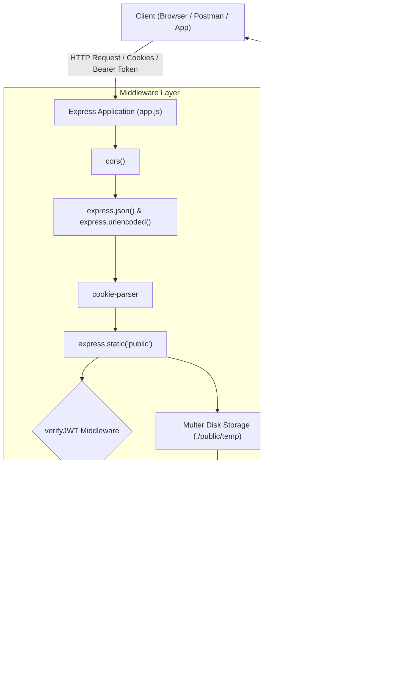

# 📹 YouTube Backend API

A robust, production-grade RESTful API backend for a video-sharing and streaming platform (YouTube Clone), built with **Node.js**, **Express.js**, **MongoDB**, and **Cloudinary**.

[](https://nodejs.org/)
[](https://expressjs.com/)
[](https://mongoosejs.com/)
[](https://cloudinary.com/)
[](https://jwt.io/)
[](https://opensource.org/licenses/ISC)

---

## 📑 Table of Contents

- [Overview](#-overview)
- [Key Features](#-key-features)
- [System Architecture](#-system-architecture)
- [Data Models & Schema Design](#-data-models--schema-design)
- [Tech Stack](#-tech-stack)
- [Project Directory Structure](#-project-directory-structure)
- [API Endpoints Reference](#-api-endpoints-reference)
- [Standardized Response & Error Format](#-standardized-response--error-format)
- [Getting Started](#-getting-started)
  - [Prerequisites](#prerequisites)
  - [Installation & Setup](#installation--setup)
  - [Environment Variables](#environment-variables)
  - [Running the Server](#running-the-server)
- [Postman Workspace](#-postman-workspace)
- [License](#-license)

---

## 🚀 Overview

This backend service powers core video platform capabilities including secure user authentication, profile management with cloud media uploads, channel subscriber analytics via MongoDB aggregation pipelines, and watch history tracking.

Designed following clean architecture patterns with asynchronous request wrappers, custom error handlers, and modular routing.

---

## ✨ Key Features

- **🔐 Robust Authentication & Security**:
  - Encrypted password storage using `bcrypt` salting & hashing via Mongoose pre-save hooks.
  - Dual-token authentication strategy using short-lived **Access Tokens** and long-lived **Refresh Tokens**.
  - Secure token storage via `httpOnly` and `secure` HTTP cookies and `Authorization: Bearer` headers.
  - Refresh token rotation mechanism for seamless session continuity.
- **🖼️ Media & Asset Management**:
  - Multi-part file upload processing using `multer` with temporary local disk buffering.
  - Automated cloud asset uploads and optimizations via **Cloudinary SDK v2**.
  - Automated cleanup of temporary local files upon successful or failed uploads.
- **📊 Channel & Analytics Pipelines**:
  - Complex MongoDB Aggregation Pipelines calculating total subscriber counts and subscribed channels count.
  - Dynamic `isSubscribed` boolean evaluation relative to the requesting authenticated user.
- **🕒 Watch History & Relations**:
  - Deep aggregation pipeline populating nested video details and owner profiles within user watch histories.
- **⚡ Developer-Friendly Architecture**:
  - Global `asyncHandler` higher-order utility eliminating repetitive `try-catch` boilerplate.
  - Standardized `ApiResponse` and `ApiError` structures for consistent API consumer integration.

---

## 🏗 System Architecture



---

## 🗄 Data Models & Schema Design

The full interactive entity-relationship diagram and schema design can be viewed on Eraser:

🔗 **[Eraser.io Data Model Diagram](https://app.eraser.io/workspace/YtPqZ1VogxGy1jzIDkzj)**

### Core Entities

| Model | Description | Key Fields |
| :--- | :--- | :--- |
| **`User`** | Platform user accounts and channel identity | `username`, `email`, `fullName`, `avatar`, `coverImage`, `password`, `refreshToken`, `watchHistory` |
| **`Video`** | Uploaded video metadata and cloud references | `videoFile`, `thumbnail`, `title`, `description`, `duration`, `views`, `isPublished`, `owner` |
| **`Subscription`** | Channel subscription relationships | `subscriber` (User ref), `channel` (User ref) |

---

## 🛠 Tech Stack

| Technology | Purpose |
| :--- | :--- |
| **Node.js** (ES Modules) | Server runtime environment |
| **Express.js (v5)** | Web framework & HTTP routing |
| **MongoDB** | Primary NoSQL document database |
| **Mongoose (v9)** | MongoDB ODM & schema management |
| **JSON Web Token (jsonwebtoken)** | Access and refresh token generation & verification |
| **bcrypt** | Secure password hashing |
| **Multer** | Multipart form-data / file upload handling |
| **Cloudinary** | Cloud storage for avatars, thumbnails, and media |
| **mongoose-aggregate-paginate-v2** | Aggregation pagination plugin |
| **dotenv** | Environment variable management |
| **cors** & **cookie-parser** | Cross-Origin resource sharing & cookie parsing |
| **nodemon** | Development live reload |
| **Prettier** | Code formatting |

---

## 📁 Project Directory Structure

```text
Youtube/
├── .postman/                     # Postman workspace configuration
├── postman/                      # Postman collections & request YAMLs
│   └── collections/
│       └── youtube backend project/
├── public/                       # Static assets directory
│   └── temp/                     # Temporary upload directory for Multer
├── src/                          # Application source code
│   ├── controllers/              # Route controller functions
│   │   └── user.controller.js    # User authentication, profile & analytics logic
│   ├── db/                       # Database connection logic
│   │   └── index.js              # Mongoose connection initialization
│   ├── middleware/               # Express custom middlewares
│   │   ├── auth.middleware.js    # JWT authentication & verification middleware
│   │   └── multer.middleware.js  # Multer storage configuration
│   ├── models/                   # Mongoose data models
│   │   ├── subscription.model.js # Subscription relation schema
│   │   ├── user.model.js         # User schema with bcrypt & JWT methods
│   │   └── video.model.js        # Video schema with aggregate pagination
│   ├── routes/                   # API route definitions
│   │   └── user.routes.js        # /api/v1/users routes mapping
│   ├── utils/                    # Shared helper utilities
│   │   ├── ApiError.js           # Standardized API error class
│   │   ├── ApiResponse.js        # Standardized API response wrapper
│   │   ├── asyncHandler.js       # Asynchronous error handling wrapper
│   │   └── cloudinary.js         # Cloudinary file upload helper
│   ├── app.js                    # Express app configuration & middleware setup
│   ├── constants.js              # Project-level constants (e.g. DB_NAME)
│   └── index.js                  # Application entry point & server bootstrap
├── .env.sample                   # Environment variable template
├── .gitignore                    # Git ignored files & directories
├── .prettierrc                   # Prettier code formatting rules
├── .prettierignore               # Prettier ignore file
├── package.json                  # Dependencies, scripts & metadata
└── README.md                     # Project documentation
```

---

## 🔌 API Endpoints Reference

Base URL: `http://localhost:8000/api/v1`

### 👤 User & Authentication Routes (`/users`)

| Method | Endpoint | Auth | Request Body / Files | Description |
| :--- | :--- | :---: | :--- | :--- |
| `POST` | `/users/register` | ❌ | `multipart/form-data` (`fullName`, `email`, `username`, `password`, `avatar` [file], `coverImage` [file]) | Register a new user and upload avatar & cover image |
| `POST` | `/users/login` | ❌ | `JSON` (`username` or `email`, `password`) | Authenticate user and issue access/refresh token cookies |
| `POST` | `/users/logout` | 🔒 | *None* | Clear tokens and log user out |
| `POST` | `/users/refresh-token` | ❌ / 🍪 | `JSON` (`refreshToken`) or Cookie | Issue new access and refresh token pair |
| `POST` | `/users/change-password` | 🔒 | `JSON` (`oldPassword`, `newPassword`) | Update current user's password |
| `GET` | `/users/current-user` | 🔒 | *None* | Retrieve currently logged-in user profile |
| `PATCH` | `/users/update-account` | 🔒 | `JSON` (`fullName`, `email`) | Update basic user account info |
| `PATCH` | `/users/avatar` | 🔒 | `multipart/form-data` (`avatar` [file]) | Update user profile picture (uploaded to Cloudinary) |
| `PATCH` | `/users/cover-image` | 🔒 | `multipart/form-data` (`coverImage` [file]) | Update channel cover banner (uploaded to Cloudinary) |
| `GET` | `/users/c/:username` | 🔒 | *URL Param* (`username`) | Fetch channel profile with subscriber count & subscription status |
| `GET` | `/users/history` | 🔒 | *None* | Retrieve authenticated user's populated watch history |

> **Note**: 🔒 Indicates endpoints requiring valid JWT token in cookies (`accessToken`) or `Authorization: Bearer <token>` header.

---

## 📦 Standardized Response & Error Format

### Success Response (`ApiResponse`)
```json
{
  "statusCode": 200,
  "data": {
    "user": {
      "_id": "65fc123456789abcdef01234",
      "username": "johndoe",
      "email": "john@example.com",
      "fullName": "John Doe",
      "avatar": "https://res.cloudinary.com/...",
      "coverImage": "https://res.cloudinary.com/..."
    }
  },
  "message": "User logged in successfully",
  "success": true
}
```

### Error Response (`ApiError`)
```json
{
  "statusCode": 401,
  "data": null,
  "message": "Invalid access token",
  "success": false,
  "errors": []
}
```

---

## 🏁 Getting Started

### Prerequisites

Ensure you have the following installed on your machine:
- [Node.js](https://nodejs.org/) (v18.x or later recommended)
- [MongoDB](https://www.mongodb.com/) (Local instance or MongoDB Atlas cluster)
- [Cloudinary Account](https://cloudinary.com/) (For cloud media storage)
- [Git](https://git-scm.com/)

### Installation & Setup

1. **Clone the repository:**
   ```bash
   git clone https://github.com/adithya-m-05/youtube-backend-.git
   cd Youtube
   ```

2. **Install dependencies:**
   ```bash
   npm install
   ```

3. **Configure environment variables:**
   Copy `.env.sample` to `.env` and populate your credentials:
   ```bash
   cp .env.sample .env
   ```

### Environment Variables

| Variable | Description | Example |
| :--- | :--- | :--- |
| `PORT` | Port number the Express server listens on | `8000` |
| `MONGODB_URI` | MongoDB connection URI string | `mongodb://localhost:27017/` |
| `CORS_ORIGIN` | Allowed origin for Cross-Origin Resource Sharing | `*` or `http://localhost:3000` |
| `ACCESS_TOKEN_SECRET` | Secret key for signing Access JWTs | `your_super_secret_access_key` |
| `ACCESS_TOKEN_EXPIRY` | Access token time-to-live | `1d` |
| `REFRESH_TOKEN_SECRET`| Secret key for signing Refresh JWTs | `your_super_secret_refresh_key` |
| `REFRESH_TOKEN_EXPIRY`| Refresh token time-to-live | `10d` |
| `CLOUDINARY_CLOUD_NAME`| Cloudinary cloud identifier | `your_cloud_name` |
| `CLOUDINARY_API_KEY` | Cloudinary API Key | `your_api_key` |
| `CLOUDINARY_API_SECRET`| Cloudinary API Secret | `your_api_secret` |

### Running the Server

- **Development Mode (with auto-reloading via Nodemon):**
  ```bash
  npm run dev
  ```

Once started, the server will output:
```text
MongoDB connected!! DB HOST: 127.0.0.1
Server is running on port 8000
```

---

## 📬 Postman Workspace

A Postman configuration and collection is included in the [`postman/`](./postman) directory. You can import the requests directly into Postman or the Postman VS Code extension to test all endpoints out of the box.

---

## 📄 License

This project is licensed under the [ISC License](https://opensource.org/licenses/ISC).

**Author**: [adithya](https://github.com/adithya-m-05)
